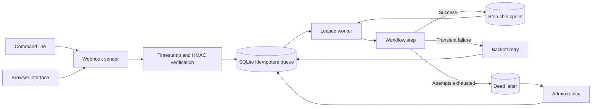

# Event Automation Agent

## About

This service turns incoming events into reliable background work. It checks that a webhook was signed by a trusted sender, stores the event, and processes it through a workflow. If a step fails, the service retries it with backoff. After repeated failure, it keeps the job in a dead-letter queue so an operator can inspect and replay it.

### What you can do

- Receive signed webhooks without processing the same event ID twice.
- Run built-in logging or configured HTTPS forwarding workflows.
- Inspect job status, retry attempts, queue metrics, and dead letters.
- Add your own multi-step workflow with durable checkpoints.

Run it as a local HTTP service or with Docker Compose; the CLI and operator browser help manage the queue. The browser is an operator interface, and handlers must be safe to repeat because delivery can happen more than once. This service is not deployed at a public URL yet.

## Quick start

The installed `event-agent` command starts the service and operates it. Set `WEBHOOK_SECRET` and `ADMIN_TOKEN`, then run `event-agent serve`. In another terminal, run `event-agent send log '{"source":"example"}'`, `event-agent metrics`, or `event-agent job EVENT_ID`. The service also serves an operator browser at `http://127.0.0.1:8080/` for event submission, queue metrics, job inspection, and dead-letter replay. Enter the admin token in the browser; it is not embedded in the page.

Requires Python 3.11 or newer. From this repository:

```powershell
python -m venv .venv
.\.venv\Scripts\Activate.ps1
python -m pip install -e '.[dev]'
pytest -q
```

On macOS or Linux:

```bash
python3 -m venv .venv
source .venv/bin/activate
python -m pip install -e '.[dev]'
pytest -q
```

Set `WEBHOOK_SECRET` as shown in `.env.example`. The test suite needs no secret.

```powershell
# PowerShell, after setting WEBHOOK_SECRET to a value of at least 16 bytes:
$env:WEBHOOK_SECRET = "replace-with-a-long-random-secret"
$env:APP_DB = "events.sqlite3"
python -m event_automation_agent
# POST JSON to /webhooks/log with X-Event-ID, X-Timestamp and X-Signature-256:
# signature = HMAC-SHA256(WEBHOOK_SECRET, timestamp + b"." + event_id + b"." + raw_body).hexdigest()
```

## Architecture



| Component | Responsibility |
|---|---|
| Ingress | Validates signed event ID, timestamp, and bounded JSON body. |
| Queue | Deduplicates events and persists attempts, leases, and step position. |
| Worker | Executes registered steps with retry and dead-letter handling. |

HTTP webhook -> timestamp and HMAC verification -> SQLite insert or duplicate detection -> worker lease -> registered handler -> completed, backoff retry, or dead letter.

See [ARCHITECTURE.md](ARCHITECTURE.md) for components, state, failure behavior, and operations.

## Deployment and safety

The built-in `log` workflow is a safe runnable example. Register real workflow handlers in application code. Handlers must be idempotent because a crash or lease expiry can cause at least once delivery. Mount /data on persistent storage in Docker.

Set `WEBHOOK_FORWARD_URL` to enable the `forward` workflow, which records the event and sends its JSON payload to a configured HTTPS endpoint. `WEBHOOK_FORWARD_TOKEN` adds bearer authentication. Set `ADMIN_TOKEN` to read authenticated `GET /metrics`. Library users can register a `Workflow` of several steps; the SQLite checkpoint records the completed step before the next worker pass. Side effects in each step still require idempotency keys.

Handlers receive the event ID in `_event_id`; the forward workflow also sends it in the `Idempotency-Key` header so downstream services can deduplicate a replay.

Operators can use authenticated `GET /jobs/{event_id}` to inspect a job and `POST /dead/requeue` with `{"event_id":"..."}` to retry a dead letter after repairing the downstream issue. These endpoints require `X-Admin-Token`.

For a single-node deployment, copy `.env.example` to `.env`, replace the example secrets with random values, and run `docker compose up --build -d`. The compose file binds port 8080 to localhost and persists the queue in `agent_data`. Terminate TLS at a reverse proxy before exposing webhooks publicly.

See [OPERATIONS.md](OPERATIONS.md) for deployment checks, monitoring, dead-letter replay, backup, and recovery.

A Dockerfile is included for the HTTP service. Set secrets through your deployment platform and persist the SQLite database on a mounted volume.

## Verification

`pytest -q` runs deterministic tests. GitHub Actions runs the same suite on pushes and pull requests.

## Product guide

### What happens to an event

1. The sender posts JSON with an event ID, timestamp, and HMAC signature. The ingress checks the signature and timestamp before accepting the body.
2. The SQLite queue stores the event once by its idempotency key. A duplicate delivery does not create a second independent job.
3. A worker leases the job and runs its registered workflow steps. Completed steps are checkpointed.
4. A transient failure schedules another attempt with backoff. Exhausted attempts move to the dead-letter state.
5. An operator inspects the job and can requeue a dead letter after fixing the underlying problem.

| Interface | Purpose |
|---|---|
| `/webhooks/{workflow}` | Signed webhook ingress. |
| `event-agent send` | Send a signed event from the CLI. |
| `event-agent job` and `metrics` | Inspect one job or overall queue health. |
| Operator browser | Submit events, inspect jobs, and replay dead letters with the admin token. |

### Built-in workflows and custom steps

`log` is a safe way to prove the queue and worker are running. `forward` sends the event JSON to a configured HTTPS endpoint when `WEBHOOK_FORWARD_URL` is set; `WEBHOOK_FORWARD_TOKEN` adds bearer authorization. Applications can register a `Workflow` with several steps. Each handler receives `_event_id`, and forwarding includes an `Idempotency-Key` header. Downstream operations must still deduplicate replays because the queue guarantees at-least-once processing, not exactly-once side effects.

### Configuration and operations

| Setting | Purpose |
|---|---|
| `WEBHOOK_SECRET` | HMAC key shared with the sender. |
| `ADMIN_TOKEN` | Access to operator routes and the browser. |
| `APP_DB` | SQLite queue file. |
| `WEBHOOK_FORWARD_URL`, `WEBHOOK_FORWARD_TOKEN` | Optional forwarding destination and credential. |

Run `docker compose up --build -d` for a single-node installation with a persisted `agent_data` volume. The supplied Compose file binds to localhost; place TLS and an authenticated reverse proxy in front of a public webhook endpoint. Back up the queue, watch dead-letter counts and retry age, and test replay after changes. [OPERATIONS.md](OPERATIONS.md) covers monitoring, backup, and recovery; [ARCHITECTURE.md](ARCHITECTURE.md) describes the queue and lease model.

### Common issues

| Symptom | Check |
|---|---|
| Webhook is rejected | Check the shared secret, timestamp freshness, event ID, and signature over the exact raw body. |
| A duplicate send does nothing | The event ID is an idempotency key; use a new ID for a new event. |
| A job remains pending | Confirm the worker is running and inspect lease and retry times. |
| A job is dead-lettered | Inspect the error and downstream service, fix it, then requeue deliberately. |

Replaying a dead letter can repeat a side effect from an earlier attempt. Use the event ID in downstream idempotency checks, and test that behavior before connecting the service to payments, messaging, or other consequential workflows.

## License

MIT. See [LICENSE](LICENSE).
