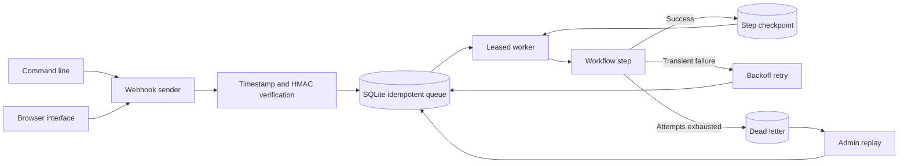

# Event Automation Agent

Accept timestamped HMAC signed webhooks, queue events with idempotency keys, retry failures, and retain dead letters.

## Quick start

The installed `event-agent` command starts the service and operates it. Set `WEBHOOK_SECRET` and `ADMIN_TOKEN`, then run `event-agent serve`. In another terminal, run `event-agent send log '{"source":"example"}'`, `event-agent metrics`, or `event-agent job EVENT_ID`. The service also serves an operator browser at `http://127.0.0.1:8080/` for event submission, queue metrics, job inspection, and dead-letter replay. Enter the admin token in the browser; it is not embedded in the page.

Requires Python 3.11 or newer. From this repository:

```powershell
python -m venv .venv
.\.venv\Scripts\Activate.ps1
python -m pip install -e '.[dev]'
pytest -q
```

On macOS or Linux:

```bash
python3 -m venv .venv
source .venv/bin/activate
python -m pip install -e '.[dev]'
pytest -q
```

Set `WEBHOOK_SECRET` as shown in `.env.example`. The test suite needs no secret.

```powershell
# PowerShell, after setting WEBHOOK_SECRET to a value of at least 16 bytes:
$env:WEBHOOK_SECRET = "replace-with-a-long-random-secret"
$env:APP_DB = "events.sqlite3"
python -m event_automation_agent
# POST JSON to /webhooks/log with X-Event-ID, X-Timestamp and X-Signature-256:
# signature = HMAC-SHA256(WEBHOOK_SECRET, timestamp + b"." + event_id + b"." + raw_body).hexdigest()
```

## Architecture



| Component | Responsibility |
|---|---|
| Ingress | Validates signed event ID, timestamp, and bounded JSON body. |
| Queue | Deduplicates events and persists attempts, leases, and step position. |
| Worker | Executes registered steps with retry and dead-letter handling. |

HTTP webhook -> timestamp and HMAC verification -> SQLite insert or duplicate detection -> worker lease -> registered handler -> completed, backoff retry, or dead letter.

See [ARCHITECTURE.md](ARCHITECTURE.md) for components, state, failure behavior, and operations.

## Deployment and safety

The built-in `log` workflow is a safe runnable example. Register real workflow handlers in application code. Handlers must be idempotent because a crash or lease expiry can cause at least once delivery. Mount /data on persistent storage in Docker.

Set `WEBHOOK_FORWARD_URL` to enable the `forward` workflow, which records the event and sends its JSON payload to a configured HTTPS endpoint. `WEBHOOK_FORWARD_TOKEN` adds bearer authentication. Set `ADMIN_TOKEN` to read authenticated `GET /metrics`. Library users can register a `Workflow` of several steps; the SQLite checkpoint records the completed step before the next worker pass. Side effects in each step still require idempotency keys.

Handlers receive the event ID in `_event_id`; the forward workflow also sends it in the `Idempotency-Key` header so downstream services can deduplicate a replay.

Operators can use authenticated `GET /jobs/{event_id}` to inspect a job and `POST /dead/requeue` with `{"event_id":"..."}` to retry a dead letter after repairing the downstream issue. These endpoints require `X-Admin-Token`.

For a single-node deployment, copy `.env.example` to `.env`, replace the example secrets with random values, and run `docker compose up --build -d`. The compose file binds port 8080 to localhost and persists the queue in `agent_data`. Terminate TLS at a reverse proxy before exposing webhooks publicly.

See [OPERATIONS.md](OPERATIONS.md) for deployment checks, monitoring, dead-letter replay, backup, and recovery.

A Dockerfile is included for the HTTP service. Set secrets through your deployment platform and persist the SQLite database on a mounted volume.

## Verification

`pytest -q` runs deterministic tests. GitHub Actions runs the same suite on pushes and pull requests.

## License

MIT. See [LICENSE](LICENSE).
